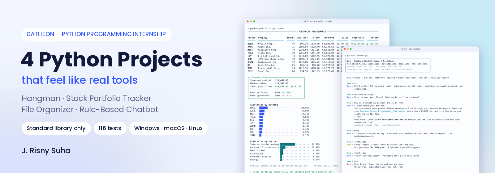
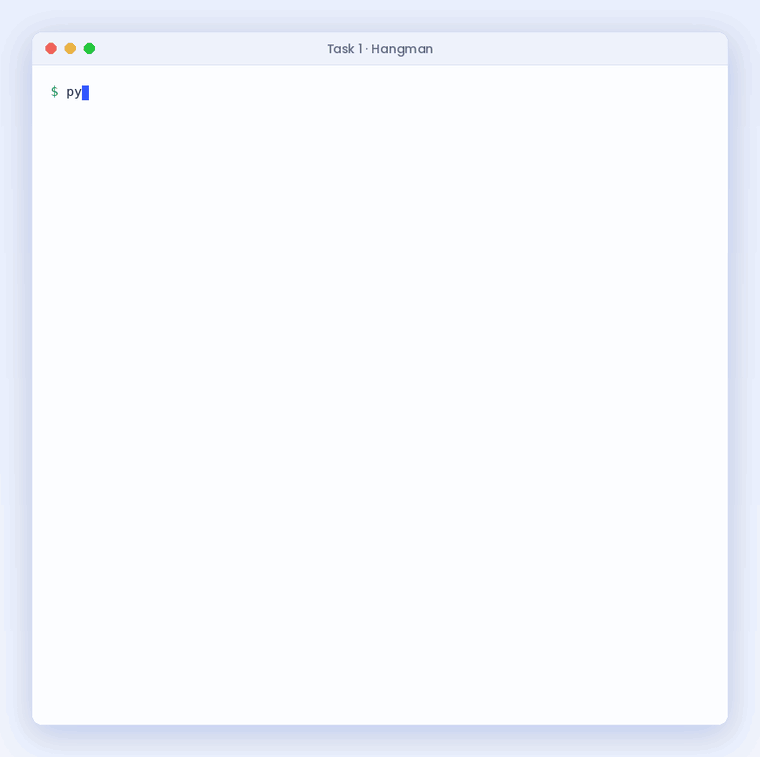
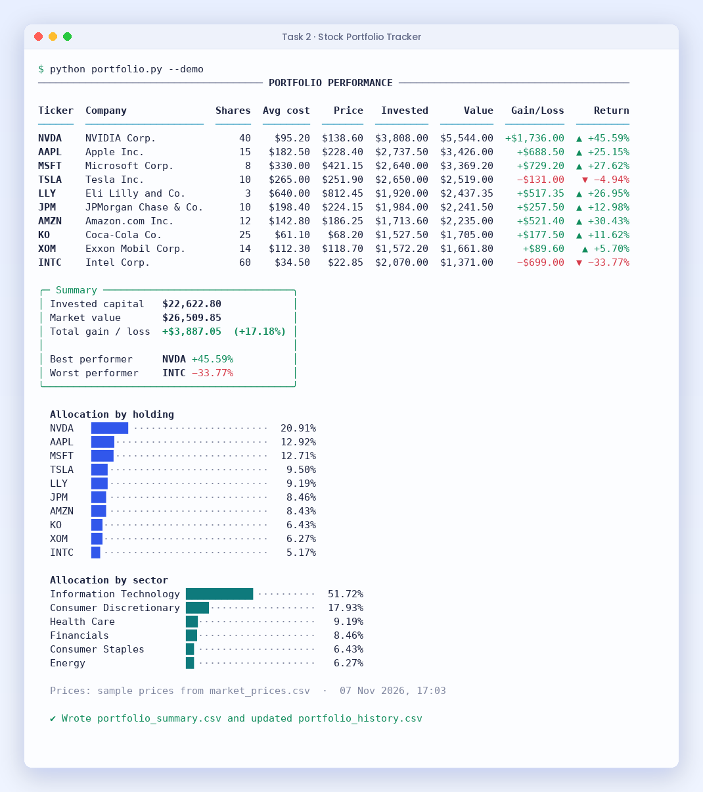
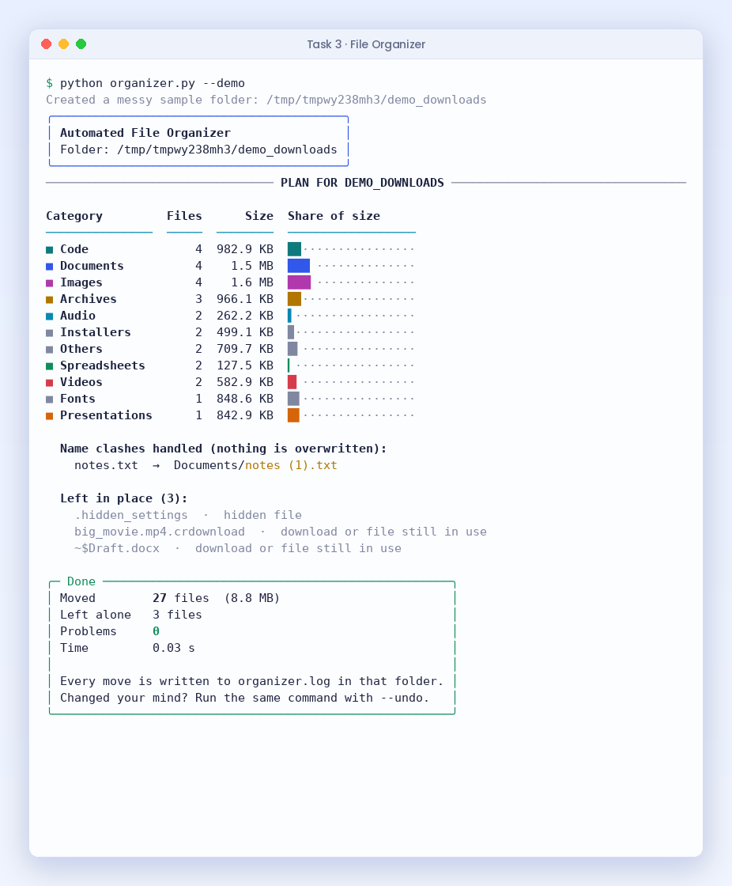
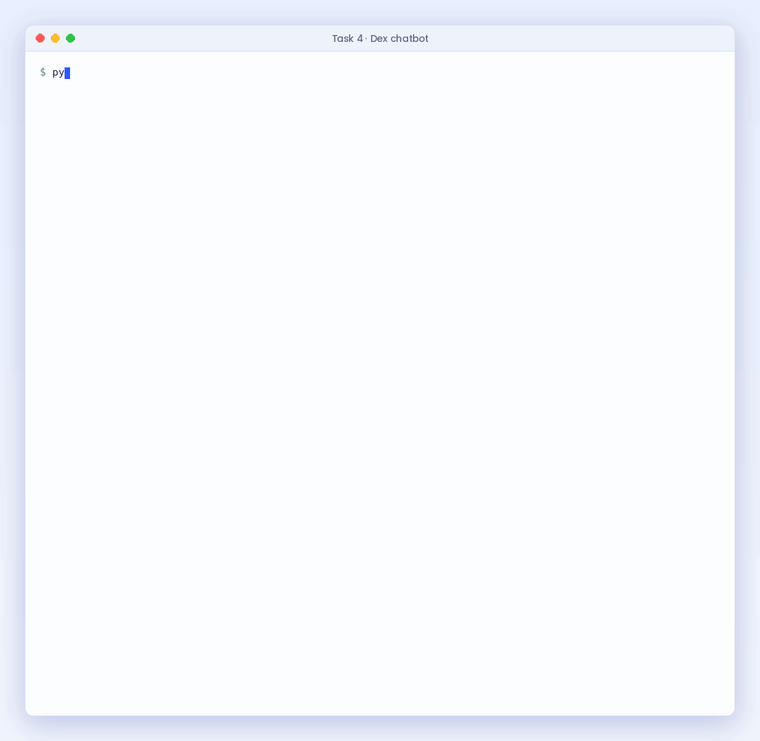

<div align="center">



# Datheon · Python Programming Internship

**All four tasks, built as polished command-line tools in pure Python.**

[](https://github.com/DevRisny/Datheon_Python_Programming_Internship/actions/workflows/tests.yml)

-03b8d9?style=flat-square)


[Task 1 · Hangman](#-task-1--hangman-word-guessing-game) ·
[Task 2 · Portfolio Tracker](#-task-2--stock-portfolio-performance-tracker) ·
[Task 3 · File Organizer](#-task-3--automated-file-organizer--cleanup-utility) ·
[Task 4 · Chatbot](#-task-4--rule-based-terminal-assistant-dex) ·
[Run it](#-run-it-in-1-minute) ·
[Testing](#-testing)

</div>

---

## 📌 At a glance

| | Task | Run it | What makes it stand out |
|:-:|---|---|---|
| 1 | **Hangman Word Guessing Game** | `python hangman.py` | ASCII gallows for every mistake, 5 word categories, 3 difficulty levels, hints, whole-word guesses and a saved scoreboard with streaks |
| 2 | **Stock Portfolio Performance Tracker** | `python portfolio.py` | Exact money maths with `Decimal`, gain/loss per holding, average cost when you buy more, sector allocation charts, `portfolio_summary.csv` plus a history log |
| 3 | **Automated File Organizer** | `python organizer.py` | Preview before moving, never overwrites (`file (1).pdf`), skips unfinished downloads, logs every move, and **undoes** the last run |
| 4 | **Rule-Based Terminal Assistant** | `python chatbot.py` | Regex + keyword + fuzzy matching, several questions in one message, remembers your name, "tell me more" follow-ups, typo suggestions, and knows if support is open right now |

**No installs needed:** every program uses only the Python standard library (Python 3.9+). Colours turn off by themselves when output is saved to a file, or with `--no-color`.

---

## 🎮 Task 1 · Hangman Word Guessing Game

> *Brief:* a terminal Hangman with ASCII gallows that update on each wrong guess, 6 attempts, guessed letters tracked, no penalty for repeats, clean victory and defeat screens.

<p align="center"></p>

| Requirement from the brief | How it is done |
|---|---|
| `hangman.py` picks a word with `random.choice()` | [`hangman_core.py`](task1_hangman/hangman_core.py) · `pick_word()` |
| Masked word like `_ A _ H E O N` | `HangmanGame.masked()` (phrases such as *Sri Lanka* show their spaces) |
| Maximum 6 mistakes with ASCII art per stage | [`hangman_art.py`](task1_hangman/hangman_art.py): 7 drawings, red when you are close to losing |
| Track guessed letters, no penalty for repeats | correct letters in a `set`, wrong ones in order; a repeat returns `Outcome.REPEAT` |
| Victory / defeat screens | big ASCII banners plus a result box with score and stats |

**Extras:** word lists in 5 categories (Animals, Countries, Programming, Fruits, Sri Lanka) or your own file (`--wordlist`), Easy / Medium / Hard by word length, `?` for a hint (costs a life, never on your last one), `!word` to guess the whole answer for a bonus, a score system, and a scoreboard saved between games (played, won, win rate, streak, best score).

```bash
cd task1_hangman
python hangman.py                        # menu: category and difficulty
python hangman.py -c "sri lanka" -d hard
python hangman.py --wordlist english_words.txt
```

---

## 📈 Task 2 · Stock Portfolio Performance Tracker

> *Brief:* enter ticker symbols, buy prices and share quantities; compute total value and gain/loss per holding; log the summary to a CSV file.

<p align="center"></p>

| Requirement from the brief | How it is done |
|---|---|
| `portfolio.py` takes tickers, buy prices and quantities | interactive menu (add / sell / view / save / history) or `--holdings my.csv` |
| Positions stored in a dictionary | `Portfolio.holdings: dict[str, Holding]` in [`portfolio_core.py`](task2_portfolio/portfolio_core.py) |
| Current prices from a sample CSV or live | [`data/market_prices.csv`](task2_portfolio/data/market_prices.csv) (40 S&P 500 stocks), or `--live` with the optional `yfinance` package |
| Invested capital vs market value, gain/loss % | per holding and in total, with best and worst performer |
| Write `portfolio_summary.csv` with the `csv` module | one row per holding plus a TOTAL row and a timestamp |

**Extras:** money is calculated with `Decimal`, so totals are exact to the cent; buying the same stock again updates the **average cost**; selling part of a holding; allocation bars by holding and by **sector**; `portfolio_history.csv` gets one line per run, so you can follow performance over time; typo help (`APPL` → *Did you mean AAPL?*); input like `$1,250.50` is understood; bad input never crashes the program.

```bash
cd task2_portfolio
python portfolio.py --demo        # sample portfolio: report + CSV files
python portfolio.py               # build your own portfolio
python portfolio.py --live        # real prices (pip install yfinance)
```

> The bundled prices are a **sample snapshot for learning**, not live market data.

---

## 🗂️ Task 3 · Automated File Organizer & Cleanup Utility

> *Brief:* sort a cluttered folder such as Downloads into category folders (Documents, Images, Videos, Archives, Code) by extension, moving files safely and handling permission errors and name clashes.

<p align="center"></p>

| Requirement from the brief | How it is done |
|---|---|
| `organizer.py` with an extension → category dictionary | 10 categories and 90 extensions in [`organizer_core.py`](task3_file_organizer/organizer_core.py) |
| `os.scandir()` + `shutil.move()` | `make_plan()` scans, `execute()` moves |
| Handle `PermissionError` / `FileExistsError` | each file is tried on its own; problems are listed and logged, the rest still move |
| Formatted summary of files moved | a plan table by category with sizes, then a result box |
| Logging output | every move goes to `organizer.log` through Python's `logging` module |

**Extras:** `--dry-run` preview, a confirmation question before anything moves, **never overwrites** (`report (1).pdf`), keeps double extensions like `.tar.gz`, leaves unfinished downloads (`.crdownload`, `.part`), Office lock files and hidden files alone, refuses to touch a drive root, your home folder or system folders, and `--undo` puts every file back. Try it safely with `--demo`, which creates a messy sample folder.

```bash
cd task3_file_organizer
python organizer.py --demo                  # safe sample folder
python organizer.py ~/Downloads --dry-run   # see the plan first
python organizer.py ~/Downloads             # organize (asks first)
python organizer.py ~/Downloads --undo      # put everything back
```

---

## 💬 Task 4 · Rule-Based Terminal Assistant (Dex)

> *Brief:* a rule-based support assistant that parses input with keywords and regular expressions, answers business-hours and FAQ questions, falls back when it does not understand, and exits on `bye`, `exit` or `quit`.

<p align="center"></p>

| Requirement from the brief | How it is done |
|---|---|
| `chatbot.py` with intents loaded from JSON | Datheon's own [`sample_faq.json`](task4_chatbot/data/sample_faq.json) + 12 intents in [`intents.json`](task4_chatbot/data/intents.json) |
| Normalise input: lower-case, strip, regex keywords | `normalise()` also expands contractions (*what's → what is*) and `stem()` matches word forms |
| State: greeting → intent → resolution → exit | `State.GREETING → LISTENING → ENDED` in [`chatbot_core.py`](task4_chatbot/chatbot_core.py) |
| Graceful fallback when confidence is low | a confidence score per intent; when unsure it suggests the closest topics |
| Exit commands | `bye`, `exit`, `quit`, `goodbye`, Ctrl+C, with a summary of topics covered |

**How Dex understands a message:** regex patterns (+3), keywords (+1 each) and similarity to the official FAQ questions are added into a score for each intent. Answers come only above a confidence threshold.

**Extras:** answers **two or three questions in one message** (*"How do I submit and is it free?"*), remembers your name (*"my name is Risny"*) without mistaking *"I'm confused"* for a name, `more` for follow-up details, typo correction (*"certficate"* → Certificates), says whether the support team is **online right now** (Mon–Fri 9–6 IST), help menu, after two misses offers a human contact, and `--transcript` saves the chat.

```bash
cd task4_chatbot
python chatbot.py
python chatbot.py --ask "When will I get my certificate and is it free?"
```

---

## 🚀 Run it in 1 minute

```bash
git clone https://github.com/DevRisny/Datheon_Python_Programming_Internship.git
cd Datheon_Python_Programming_Internship
python task1_hangman/hangman.py
python task2_portfolio/portfolio.py --demo
python task3_file_organizer/organizer.py --demo
python task4_chatbot/chatbot.py
```

Python 3.9 or newer, nothing to install. On Windows use `py` instead of `python` if needed.

---

## 🧪 Testing

**116 automated tests** with `pytest` cover the game rules, money maths, file moves (including permission errors, name clashes and undo) and every chatbot intent. GitHub Actions runs them on **Windows, macOS and Linux with Python 3.9, 3.11 and 3.13** (9 combinations), then runs every program once.

| Task | Tests | Examples of what is checked |
|---|:-:|---|
| Hangman | 25 | repeats cost nothing, 6 mistakes lose, hints, whole-word guesses, scoreboard, a full game from the command line |
| Portfolio | 24 | gain/loss and weights, average cost, exact decimals, bad input, CSV summary and history |
| File Organizer | 33 | every category, dry run, no overwriting, permission errors, undo, refusing system folders |
| Chatbot | 34 | 13 example questions, multi-question messages, name memory, follow-ups, fallbacks, exit commands |

```bash
pip install pytest
python -m pytest task1_hangman task2_portfolio task3_file_organizer task4_chatbot
```

> Run each folder separately (`python -m pytest task1_hangman`, and so on) because every task is a stand-alone project with its own copy of `term.py`.

---

## 🗂 Project structure

```
Datheon_Python_Programming_Internship/
├── task1_hangman/
│   ├── hangman.py            ← run this
│   ├── hangman_core.py       game rules (no input/output, fully tested)
│   ├── hangman_art.py        gallows drawings and banners
│   ├── hangman_stats.py      scoreboard saved as JSON
│   ├── words/                5 category word lists
│   └── tests/
├── task2_portfolio/
│   ├── portfolio.py          ← run this
│   ├── portfolio_core.py     Decimal maths, CSV summary and history
│   ├── data/                 sample market prices and sample holdings
│   └── tests/
├── task3_file_organizer/
│   ├── organizer.py          ← run this
│   ├── organizer_core.py     categories, planning, moving, undo, logging
│   └── tests/
├── task4_chatbot/
│   ├── chatbot.py            ← run this
│   ├── chatbot_core.py       normalising, intent scoring, conversation state
│   ├── data/                 Datheon FAQ dataset + intents
│   └── tests/
├── tools/record_demos.py     records the terminal demos in this README
└── .github/workflows/        tests on 3 operating systems × 3 Python versions
```

Each task folder is self-contained: it runs on its own and carries its own small `term.py` helper for colours, boxes, tables and bars.

---

<div align="center">

Built by **J. Risny Suha** for the **Datheon Python Programming Internship** (Batch 01, Nov–Dec 2026)

[GitHub](https://github.com/DevRisny) · [LinkedIn](https://www.linkedin.com/in/risny-suha-8a6b66423)

</div>
